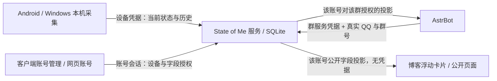

# State of Me 0.15：账号、设备与分享

## 普通用户：只需要客户端和一个服务地址

维护者提供 HTTPS 地址，例如 `https://status.example.com`，也可以带 `/presence` 路径。Android 与 Windows 都提供原生账号管理；网页 `/account` 是同一账号的另一入口，不必在浏览器和客户端间来回切换。

1. **注册或登录。** 注册后先保存恢复码，再添加本机。已有账号登录后登记本机，已经连接的设备只会复用本人所属连接。网络重试复用登记请求，避免重复添加。
2. **选择本机采集。** 应用使用名称列表与白名单／黑名单，其他信息按开关选择。新设备默认暂停，确认后开始分享。Android 的权限项显示已授权状态；仅需要且未授权的项目提供系统授权入口。账号连接成功不等于系统权限已授予。
3. **允许群友查询。** 在“QQ 群分享”输入群号，生成验证命令，在对应 QQ 群发送。返回客户端或网页刷新，核对真实 QQ 及群号后确认。新群此时仍无数据范围；读取／编辑该群字段，勾选并保存后才允许查询。群必须先由维护者接入。
4. **可选公开。** 在“公开展示”勾选字段并保存。所有公开字段可被访客读取，包括选择公开的历史汇总、应用排行和小时分布；默认不选。设备名称也是独立字段，可能包含真实姓名，请按实际意愿选择。公开地址可交给博客卡片使用，地址中不需要密钥。
5. **在任一客户端管理。** 设备移除、群范围、公开范围由同一服务器保存。多个入口同时修改会进行版本检查：冲突时保留本地草稿并提示刷新，不静默覆盖另一端刚保存的范围。

QQ 验证只证明“这个账号由该 QQ 的真实发言者控制”，不能自动开放数据。公开授权和每个群的授权彼此独立：公开了统计不等于本群可以查；本群能查也不等于博客访客能查。新增加的字段不会自动加入已有选择。

## 三层开关各自做什么

| 层级 | 设置位置 | 影响 |
| --- | --- | --- |
| 采集与上传 | 每台设备 | 这台设备收集哪些信息，应用名单如何过滤，是否暂停 |
| 账号所有权 | 后端账号与设备管理 | 谁能查看、移除设备或更改授权 |
| 受众范围 | 账号的群分享与公开展示 | 已上传的信息中，某个群或公开访客能读到哪些字段 |

受众只能拿到“本机实际上传”和“账号授权字段”的交集。勾选公开某字段不会远程开启手机权限，也不会替设备打开采集开关。当前状态与历史统计是不同数据：实时状态失联到期后消失，历史统计仍按历史权限保留和读取，不能据此认定本人在线。

账号管理会话与设备上传凭据分开。退出账号管理仅清除管理会话，后台分享可继续；断开设备则停止并撤销该设备连接。管理会话过期重新登录即可。不能用设备凭据管理账号，也不能凭另一账号登录静默接管已经连接的设备；切换账号先明确断开旧连接。

忘记密码可在原生登录界面使用恢复码重设。重设会撤销此账号的全部登录与设备凭据，生成新恢复码；先保存新码，再在各设备断开失效连接并重新登录。恢复码不是群验证命令，不应发到聊天中。

## 维护者：一个后端，多个普通用户

部署步骤见 [从零安装](QUICKSTART.md)。每个普通用户拥有独立账号和设备，服务器维护者配置注册策略、账号上限、域名及机器人接入群。机器人凭据只交给 AstrBot 服务，不交给用户。维护者能接触数据库和服务配置；这不是对维护者不可见的端到端加密系统。

- 原生注册／登录：`POST /v1/accounts/register`、`POST /v1/accounts/login`，使用 `client: "native"` 获得管理 Bearer。
- 原生设备登记：`POST /v1/accounts/devices/enroll`，提交持久化的 `enrollment_id`，由登录账号自动确认归属；已连接设备提供本人的 `existing_token` 复用。失效或别人的非空 token 被拒绝，不能自动接管。
- 字段目录：`GET /v1/accounts/info` 的 `scopes`，客户端按目录展示，不把某位部署者的账号、QQ 或群号写死。
- 管理快照：`GET /v1/accounts/me` 返回 `public_fields`、`group_scopes` 和 `scope_revision`。保存范围带 `expected_revision`，版本冲突返回 409。
- 原生管理请求带 `Authorization: Bearer <account session>`、`X-SOM-Account`、`X-SOM-CSRF: 1`；网页使用受保护 Cookie。上传凭据与管理凭据不能混用。
- 实时上传：`POST /v1/events`；历史批量上传：`POST /v1/usage`。HTTPS 代理对历史上传放宽到 1 MiB，0.17 起实时事件允许 256 KiB（有界 WhatPulse Profile 列表），其他请求保持 16 KiB。
- 群查询：`GET /v1/bot/status/{qq}` 与 `GET /v1/bot/usage/{qq}`，由服务端验证群服务凭据和用户授权。
- 公开查询：`GET /v1/public/users/{name}`，无凭据；卡片只消费这份投影。

AstrBot 根据实际事件处理“我”、真实 @、QQ 号码和 QQ API 查到的群主。普通近况由模型决定是否调用工具以及如何简短总结；插件不按问题关键词删减已授权字段。身份不明确时会追问对象，工具不能自行更换成维护者本人。历史分项缺失表示未分享或不可用，不代表零。

0.15 取消旧短码设备配对与旧权限请求兼容。后端、原生客户端、机器人插件和卡片脚本应作为一套升级。旧版本文档仅作历史记录；现有安装先备份配置和数据库，再在隔离副本验证。多用户服务尚属开发预览，没有邮箱／OAuth、跨服务器账号同步或管理后台。
